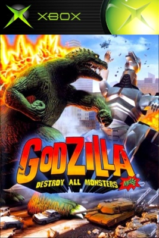

<div align="center">

# Godzilla: Destroy All Monsters Melee — Native Recompilation

**A work-in-progress native Windows port of the 2002 Xbox game, built by
statically recompiling the original executable.**

[](https://github.com/Zippingrocks/Godzilla-Destroy-All-Monsters-Melee-Recompilation/actions/workflows/ci.yml)




<sub>Original Xbox cover artwork shown for title identification. All artwork
and trademarks belong to their respective owners.</sub>

</div>

The Xbox executable is translated ahead of time into C and compiled for
x86-64, allowing the game's own code to run directly rather than through CPU
emulation. The separate
[`xboxrecomp`](https://github.com/sp00nznet/xboxrecomp) runtime provides the
replacement Xbox kernel, Direct3D/NV2A, audio, and input layers.

This project contains **no game content**. You must supply files from your own
legally obtained copy of the USA retail Xbox release.

> [!IMPORTANT]
> This is a development preview, not a playable release. The current milestone
> is an accurate and stable startup/profile/main-menu flow at 30 FPS. Gameplay
> is not ready.

## Contents

- [Status](#status)
- [Current capabilities](#current-capabilities)
- [Requirements](#requirements)
- [Installation and launch](#installation-and-launch)
- [Controls](#controls)
- [Known issues](#known-issues)
- [Building from source](#building-from-source)
- [Contributing](#contributing)
- [Reporting bugs](#reporting-bugs)
- [Project layout](#project-layout)
- [Roadmap](#roadmap)
- [Legal](#legal)
- [Credits](#credits)

## Status

| Target | Status |
| --- | --- |
| Windows 10/11 x86-64 | Development preview; startup and frontend bring-up |
| Linux / Steam Deck | Not supported |
| macOS | Not supported |
| Gameplay | Not ready |
| Pixel parity with Xemu | In progress; not yet achieved |

The recompilation boots, plays the real startup XMV sequence through the current
host bridge, accepts a skip without crashing, and reaches an animated frontend
and main-menu rendering path. Profile creation/selection and complete first-level
menu navigation are still being recovered.

See the detailed [current status](docs/status.md) for the precise working and
incomplete boundaries.

## Current capabilities

- Native x86-64 Windows executable produced from 5,277 lifted Xbox functions.
- Original startup and `mainmenu.xmv` video streams decoded at runtime—no static
  PNG menu replacement or predecoded frame cache.
- Recovered frontend callback and vtable dispatch for the current menu path.
- NV2A/Kelvin command translation through a Direct3D 11 renderer.
- Controller input plus development keyboard mapping at the retail XInput
  boundary.
- Stable startup-movie skip handoff with a verified one-minute soak.
- Hash-pinned isolated Xemu parity tooling for matching logical inputs, memory
  checkpoints, timing, and frames.
- Automated checks that reject tracked retail/runtime artifacts and validate
  the repository's public documentation and fixture metadata.

## Requirements

- Windows 10 or 11, 64-bit
- A 64-bit x86 processor
- A Direct3D 11-capable GPU with current drivers
- Your own USA retail Xbox copy of *Godzilla: Destroy All Monsters Melee*
- Several gigabytes of free space for local game data, analysis, and builds
- FFmpeg for the current host XMV bridge
- A controller is recommended; keyboard input is intended for development

The supported executable is pinned as:

| Field | Value |
| --- | --- |
| Title | `Godzilla: Melee` |
| Title ID | `0x49470039` |
| XDK | `1.0.5233` |
| Entry point | `0x0002A6D9` |
| SHA-256 | `9d0ba935e89fc36d4c6895f5a9cc8afad2e05cdd17e9183517595e404da300b8` |

The machine-readable definition is
[`fixtures/retail-xbox-us.json`](fixtures/retail-xbox-us.json). Other regions
and revisions are not currently supported.

## Installation and launch

There is no packaged release or installer yet. Build the project from source,
then place your extracted retail files under `game_files/` as described in
[Build and run](docs/build-and-run.md).

Place `ffmpeg.exe` in `tools/bin/`, expose it through `PATH`, or set
`FFMPEG_PATH`. Launch the normal startup flow with:

```powershell
.\tools\launch-menu.cmd
```

The launcher clears development overrides before starting
`bin/godzilla_damm.exe`. It does not install, download, or modify retail game
content.

## Controls

Current mappings are development-oriented and may change as the retail input
contexts are recovered.

| Action | Controller | Keyboard |
| --- | --- | --- |
| Navigate | D-pad / left stick | Arrow keys / W A S D |
| Confirm | A | Enter |
| Back | B | Escape |
| Skip startup movie | Start | Enter |

Input behavior is only considered correct when it reaches the same retail
callback boundary as the pinned Xemu reference.

## Known issues

- This is not a complete game port; gameplay entry is outside the current
  accepted milestone.
- Profile creation/selection and some menu transitions still depend on missing
  callbacks or indirect-call targets.
- Rendering is not yet pixel-identical to Xemu. Shader, texture, blend,
  lighting, render-target, and transition differences remain.
- Brief black frames, corruption, flicker, or presentation dips may still occur
  in paths that have not completed a one-minute soak.
- XMV playback currently depends on FFmpeg because the original MMX-heavy WMV2
  decoder is not fully lifted.
- Audio and exact per-logo startup timing are incomplete.
- Only the hash-pinned USA retail Xbox executable is supported.

Do not describe a visually similar capture as pixel parity. The same retail
build, state, logical input, frame, and image stage must be proven first.

## Building from source

Install Visual Studio 2022 with **Desktop development with C++** and CMake 3.20
or newer. Obtain a separate local `xboxrecomp` checkout, then configure and
build:

```powershell
git clone https://github.com/Zippingrocks/Godzilla-Destroy-All-Monsters-Melee-Recompilation.git
cd Godzilla-Destroy-All-Monsters-Melee-Recompilation
cmake -S . -B build -A x64 -DXBOXRECOMP_DIR=C:/path/to/xboxrecomp
cmake --build build --config Release
```

The executable is written to `bin/godzilla_damm.exe`. Full retail-file and
runtime-media instructions are in [Build and run](docs/build-and-run.md) and
[Local runtime assets](docs/runtime-assets.md).

Run the public repository checks with:

```powershell
python -m unittest discover -s tests -v
```

## Contributing

Bug reports, testing, callback recovery, renderer fixes, and documentation are
welcome. Read [CONTRIBUTING.md](CONTRIBUTING.md) and follow the
[Code of Conduct](CODE_OF_CONDUCT.md). Accessibility reports are covered by
[ACCESSIBILITY.md](ACCESSIBILITY.md), and vulnerabilities should follow
[SECURITY.md](SECURITY.md).

Never submit retail game data, executables, disc images, XMV files, decoded
assets, captures, saves, memory dumps, or build output.

## Reporting bugs

Use the repository's
[issue templates](https://github.com/Zippingrocks/Godzilla-Destroy-All-Monsters-Melee-Recompilation/issues/new/choose).
Include the tested commit, Windows version, CPU, GPU/driver, controller or
keyboard, exact reproduction steps, and the relevant log excerpt. For visual
issues, include a screenshot or short video after removing personal data.

Security reports must be submitted privately through
[GitHub Security Advisories](https://github.com/Zippingrocks/Godzilla-Destroy-All-Monsters-Melee-Recompilation/security/advisories/new).

## Project layout

```text
.github/             CI, issue forms, and pull-request template
docs/                architecture, build, parity, status, and roadmap
fixtures/            hashes and expected facts for supported retail builds
src/game/             host entry point and DAMM-specific runtime bridges
src/game/recomp/gen/  generated guest C and dispatch data
tests/                repository and fixture guardrails
tools/                recovery, repair, and diagnostic tooling
tools/parity/         isolated Xemu comparison lab
```

Not in the repository: game data, Xemu state, analysis databases, downloaded
toolchains, decoded media, captures, logs, dumps, saves, executables, and build
output. See [Repository layout](docs/repository-layout.md).

## Roadmap

The project advances through evidence-backed milestones:

1. Finish startup media timing and replace the temporary FFmpeg bridge.
2. Complete profile creation/selection and every first-level menu callback.
3. Pass a one-minute responsive 30 FPS soak in every unique frontend screen.
4. Eliminate remaining black frames, corruption, flicker, and frame dips.
5. Reach synchronized Xemu/recomp renderer parity for stable checkpoints.
6. Begin gameplay entry only after the frontend milestone is complete.

See the full [roadmap](docs/roadmap.md) and
[Xemu parity workflow](docs/parity-workflow.md).

## Legal

This is an independent, fan-made clean-room compatibility project. It is not
affiliated with or endorsed by Pipeworks Software, Atari, Toho, Microsoft, or
any other rights holder. *Godzilla*, related characters, game names, artwork,
audio, and other game content belong to their respective owners.

No game executable, disc image, extracted runtime data, audio, video, models,
textures, or other playable game content is distributed by this repository.
The user-supplied Xbox cover image is included only to identify the title; its
artwork and trademarks remain the property of their respective owners. Users
must supply their own legally obtained retail files. The project is intended
for interoperability, preservation research, and use with lawfully owned
copies.

No project-wide open-source license has been declared yet. Third-party
components retain their own licenses and notices.

## Credits

- [`xboxrecomp`](https://github.com/sp00nznet/xboxrecomp) contributors for the
  original-Xbox recompilation runtime.
- [`xemu`](https://github.com/xemu-project/xemu) contributors for the reference
  emulator used for behavior and rendering comparison.
- [`FFmpeg`](https://ffmpeg.org/) contributors for temporary host-side XMV/WMV2
  decoding support.
- The broader static-recompilation and game-preservation communities whose
  tooling and public research make projects like this possible.
